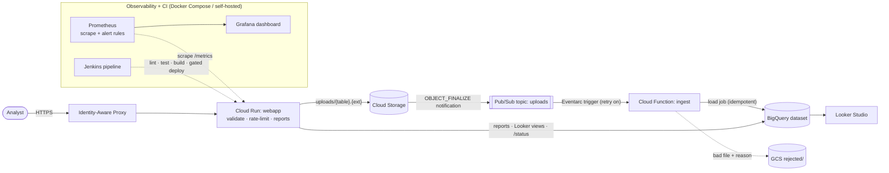
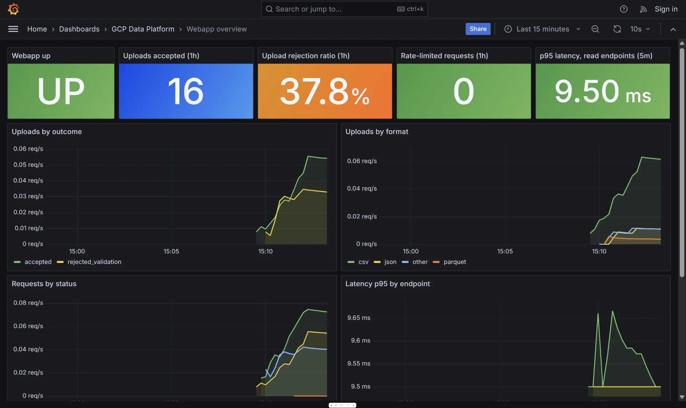
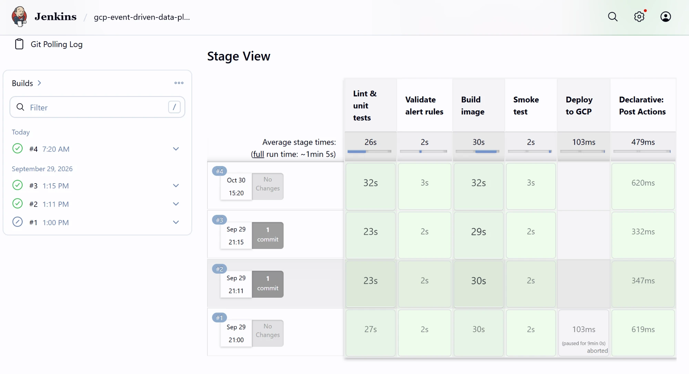

# GCP Event-Driven Data Platform

[](https://github.com/babyclaire0222-cyber/gcp-event-driven-data-platform/actions/workflows/ci.yml)

A serverless GCP pipeline for finance and ops analysts. Upload a CSV, JSON, Parquet, Excel or delimited text file, and it's validated, loaded into BigQuery through Pub/Sub and Cloud Functions, and available as Looker Studio dashboards within seconds. No data engineer needed.

> **Project status:** the code is complete and tested locally: 71 unit tests, CI, Jenkins, and a Docker demo with Prometheus and Grafana. It has **not yet been run on live GCP**. The design below and the `deployment/` scripts are unverified against real Cloud Run, Pub/Sub, Cloud Functions, BigQuery and Looker Studio, because the project has no active billing account.

## Architecture



The web app never loads data itself. It writes the file to GCS and returns `202 Accepted`. Everything after that is event-driven. The UI polls `/status/<table>` until the table is `loaded` or `rejected`.

## Features

| Capability | Where it's implemented |
|---|---|
| Multi-format ingest: CSV, newline-delimited JSON, Parquet, Excel (.xlsx/.xls) and delimited text (.txt with comma, tab or `|`), both converted to CSV | [`webapp/validation.py`](webapp/validation.py) (`ALLOWED_EXTENSIONS`), [`webapp/main.py`](webapp/main.py) (`index`), [`functions/ingest/main.py`](functions/ingest/main.py) (`SOURCE_FORMATS`) |
| Cloud Storage landing zone with 30-day lifecycle | [`webapp/main.py`](webapp/main.py) (`index`), [`deployment/create_resources.sh`](deployment/create_resources.sh) step 2 |
| Pub/Sub: GCS notification → topic | [`deployment/create_resources.sh`](deployment/create_resources.sh) step 4 |
| Cloud Functions (gen2) Pub/Sub trigger | [`functions/ingest/main.py`](functions/ingest/main.py) (`ingest`), [`deployment/deploy.sh`](deployment/deploy.sh) (`--trigger-topic --retry`) |
| BigQuery processing: load jobs + 5 templated finance reports | [`functions/ingest/main.py`](functions/ingest/main.py) (`load_job_config`), [`webapp/main.py`](webapp/main.py) (`REPORTS`, `render_report_sql`) |
| Cloud Run app layer behind IAP | [`webapp/Dockerfile`](webapp/Dockerfile), [`deployment/deploy.sh`](deployment/deploy.sh) (`--iap --no-allow-unauthenticated`) |
| Looker Studio: one BigQuery view per report | [`webapp/main.py`](webapp/main.py) (`publish_looker_views_for_table`) |
| Docker Compose, local + prod | [`docker-compose.yml`](docker-compose.yml) (hot reload + Redis), [`docker-compose.prod.yml`](docker-compose.prod.yml) (Cloud Run image, read-only FS) |
| Rate limiting (per user, Redis or in-memory) | [`webapp/ratelimit.py`](webapp/ratelimit.py) |
| Input validation (two layers) | [`webapp/validation.py`](webapp/validation.py), [`functions/ingest/main.py`](functions/ingest/main.py) (`parse_object_name`, `reject`) |
| Prometheus metrics: request latency, upload outcomes, 429s, BigQuery query time | [`webapp/metrics.py`](webapp/metrics.py), [`monitoring/prometheus/prometheus.yml`](monitoring/prometheus/prometheus.yml) |
| Prometheus alert rules: web app down, high rejection rate, p95 latency, rate-limit spike | [`monitoring/prometheus/alerts.yml`](monitoring/prometheus/alerts.yml) |
| Grafana dashboard, provisioned as code (11 panels) | [`monitoring/grafana/`](monitoring/grafana), [`docker-compose.monitoring.yml`](docker-compose.monitoring.yml) |
| Jenkins pipeline: lint, tests with JUnit report, alert-rule check, image build, smoke test, manual-approval deploy | [`Jenkinsfile`](Jenkinsfile), [`jenkins/`](jenkins) (plugins + job defined in Configuration-as-Code), [`docker-compose.jenkins.yml`](docker-compose.jenkins.yml) |
| Tests + GitHub Actions CI (lint, 71 unit tests, promtool, Docker build + smoke test) | [`tests/`](tests), [`.github/workflows/ci.yml`](.github/workflows/ci.yml) |

## Design decisions

- **Why Pub/Sub sits between GCS and the loader.** An explicit topic decouples the upload from the load. The web app replies in milliseconds instead of blocking on a BigQuery job. Pub/Sub adds at-least-once delivery with retries, the notification is scoped to `uploads/` so the function's own writes to `rejected/` don't re-trigger it, and a second consumer (data-quality checks, audit logging) can subscribe later without touching the upload path. A direct GCS trigger would also use Pub/Sub internally, but it hides the topic, so you can't add subscribers or inspect it.
- **Idempotent loads under at-least-once delivery.** Every BigQuery load job ID is `ingest_<table>_<object generation>`. If Pub/Sub delivers the same notification twice, the second `load_table_from_uri` gets `409 Conflict`, and the function waits on the existing job instead of loading twice. A re-upload creates a new object generation, so it gets a new job.
- **Validation happens twice and separates permanent from transient errors.** The web app rejects bad files before they reach GCS:
  - extension allow-list and `secure_filename` (stops path traversal)
  - a 50 MB cap (Flask returns 413)
  - magic-byte checks (a CSV renamed to `.parquet` fails)
  - a CSV header check (≥ 2 named, unique columns)
  - a newline-delimited JSON check
  - a table check for `.txt` (header, data rows, same column count on every line), so free-form notes are refused

  The function validates again, because anything with bucket access can write to `uploads/`. If a file can *never* load (bad name, empty, or a BigQuery parse error with `max_bad_records=0`), the function moves it to `rejected/`, records the reason in object metadata, and acks the message so it isn't retried forever. Transient errors are raised instead, so Pub/Sub retries them.
- **Rate limiting is keyed on identity, not IP.** Limits are per IAP-authenticated email, because `X-Forwarded-For` is set by the client and easy to spoof (see `test_spoofed_forwarded_for_does_not_reset_limit`). With `REDIS_URL` set, a fixed-window counter in Redis (`INCR` + `EXPIRE`) is shared by every process. Without Redis, each process keeps a sliding-window log in memory, and gunicorn runs as one process with 8 threads so that limit is exact per instance. Over-limit requests get `429` with a `Retry-After` header.
- **Metrics are built to stay low-cardinality.** The `endpoint` label is the route template (`/status/<table>`, not `/status/sales`), and `format`/`outcome` come from fixed sets, with unknown extensions collapsed to `other`. Uploading thousands of differently named files can't create thousands of time series. Because gunicorn runs a single process, the default Prometheus registry is accurate without multiprocess mode. Failed GCS writes are counted as `outcome="error"` and return `502`, so storage outages show up on the dashboard instead of as anonymous 500s.
- **Two CI systems, one set of checks.** GitHub Actions gives the public badge on every push. The Jenkinsfile runs the same stages on a self-hosted server and adds a deploy stage behind an `input` approval with GCP credentials from the Jenkins credential store. `beforeInput true` means the approval prompt only appears when `DEPLOY=true`. The local Jenkins has no setup wizard or UI clicks: plugins are baked into the image, and Configuration-as-Code creates the admin user and the pipeline job.
- **SQL injection is prevented, not escaped.** Table names must match `^[a-zA-Z_][a-zA-Z0-9_]{0,127}$` before they reach any query. Report column names are read from the table's BigQuery schema, never from the request.

## Run locally

**Quick demo, no GCP account.** Uploads go to a local fake Cloud Storage server. Validation, rate limiting and metrics are real; Pub/Sub, the ingest function and BigQuery aren't running, so files stop at storage and the upload page stays on "still processing":

```bash
docker compose -f docker-compose.demo.yml -f docker-compose.monitoring.yml up -d --build
python scripts/generate_traffic.py --minutes 3 --skip-status
```

**Full local run, with a GCP project.** Prerequisites: Docker, and the `gcloud` CLI logged in to a dev project where `create_resources.sh` has been run. The pipeline itself runs in GCP, so a local upload goes through the same Pub/Sub → function → BigQuery path as production.

```bash
gcloud auth application-default login
cp .env.example .env          # set GCP_PROJECT, BUCKET_NAME, DEV_USER_EMAIL
docker compose up --build     # http://localhost:8080, hot reload, Redis rate limiting
```

On Windows, first run `export GCLOUD_CONFIG_DIR="$APPDATA/gcloud"` (Git Bash) so Compose can find your credentials.

To run the exact image Cloud Run uses (gunicorn, non-root, read-only filesystem):

```bash
docker compose -f docker-compose.prod.yml up --build
```

**Monitoring.** Add the overlay to either stack, then generate some traffic:

```bash
docker compose -f docker-compose.yml -f docker-compose.monitoring.yml up --build
python scripts/generate_traffic.py --minutes 3
```

Grafana at http://localhost:3000 (the *Webapp overview* dashboard is the home page; anonymous read-only, or admin/admin). Prometheus at http://localhost:9090 (see *Alerts* for the 4 rules).

**Jenkins.** The pipeline job is created automatically and polls `master` every 5 minutes:

```bash
docker compose -f docker-compose.jenkins.yml up -d --build   # http://localhost:8081, admin/admin
```

To use the gated deploy stage, add two credentials in Jenkins: `gcp-sa-key` (secret file, a deployer service-account key) and `gcp-project-id` (secret text). Then run *Build with Parameters* with `DEPLOY` checked.

Tests don't need GCP:

```bash
pip install -r requirements-dev.txt
ruff check . && pytest
```

Try `sample_data/finance_6months.csv` (loads and powers the reports) and `sample_data/bad_rows.json` (passes the web app's first-line check, then BigQuery rejects it and it shows up as `rejected` with the reason).

## Deploy

Not yet run against a live project (see project status). The steps below describe what the scripts are written to do.

```bash
export PROJECT_ID=your-project IAP_USER=you@gmail.com
./deployment/create_resources.sh
```

What it does, in order:

1. Enables Cloud Run, Cloud Functions, Cloud Build, Artifact Registry, Eventarc, Pub/Sub, Cloud Storage, BigQuery and IAP.
2. Creates the bucket (`$PROJECT_ID-uploads`, `asia-southeast1`) with a 30-day delete rule on `uploads/` and `rejected/`.
3. Creates the BigQuery dataset `analysis_dataset` in the **same region** as the bucket.
4. Creates the Pub/Sub topic `uploads`, grants the GCS service agent `pubsub.publisher`, and adds an `OBJECT_FINALIZE` notification on the `uploads/` prefix.
5. Creates two service accounts, one per component (roles below).
6. Runs [`deploy.sh`](deployment/deploy.sh) to deploy the function and the Cloud Run service with `--iap`, then grants `IAP_USER` access.

Later code-only deploys: run `./deployment/deploy.sh`, or run the manual **Deploy** GitHub Actions workflow.

**IAM roles**

| Principal | Roles |
|---|---|
| `webapp-sa` (Cloud Run) | `storage.objectUser` on the bucket, `bigquery.dataEditor`, `bigquery.jobUser` |
| `ingest-sa` (Function + trigger) | `storage.objectUser` on the bucket, `bigquery.dataEditor`, `bigquery.jobUser`, `eventarc.eventReceiver`, `run.invoker` |
| GCS service agent | `pubsub.publisher` on the `uploads` topic |
| IAP service agent | `run.invoker` on the Cloud Run service |
| You (`IAP_USER`) | `iap.httpsResourceAccessor` on the Cloud Run service |
| Person running the script | `owner`, or `editor` + `resourcemanager.projectIamAdmin` |

If your project isn't in a Google Workspace organization, IAP may ask you to configure the OAuth consent screen the first time.

**Rough monthly cost** (portfolio-level traffic, asia-southeast1 list prices): **under $1/month**.

- Cloud Run, Cloud Functions, Pub/Sub, Cloud Build and BigQuery (10 GB storage, 1 TiB queries) all stay inside their free tiers.
- The only line items are GCS storage (~$0.02/GB) and Artifact Registry image storage beyond 0.5 GB (~$0.10/GB).
- Adding Memorystore for shared rate limiting on Cloud Run would add about $35/month, so the deployed stack doesn't include it (see limitations).

## Teardown

```bash
PROJECT_ID=your-project ./deployment/teardown.sh
```

This deletes the Cloud Run service, the function (and its Eventarc trigger), the bucket and all files, the BigQuery dataset, the topic, both service accounts, and the build image repositories. It asks you to type the project ID first. To remove *everything*, run `gcloud projects delete $PROJECT_ID`.

## Screenshots

**Grafana**, the *Webapp overview* dashboard during the local demo with `generate_traffic.py`:



**Jenkins**, the pipeline stage view:



## What I'd do next

1. **Run it on live GCP.** Deploy with `create_resources.sh`, confirm the full upload → BigQuery path, and add Looker Studio and BigQuery screenshots.
2. **Shared rate limiting in production.** The deployed Cloud Run service has no Redis, so limits apply per instance. With `--max-instances=3`, one user could in theory make 3× the configured limit. The fix is to point `REDIS_URL` at Memorystore through a VPC connector, which I skipped to keep the demo under $1/month.
3. **Verify the IAP JWT in the app.** The app trusts `X-Goog-Authenticated-User-Email` because the service only accepts traffic through IAP. Checking the signed `X-Goog-IAP-JWT-Assertion` would protect against a future misconfiguration, such as someone adding `--allow-unauthenticated`.
4. **Production observability and hardening.** Items still missing:
   - Prometheus and Grafana run with Docker Compose only; nothing scrapes the deployed Cloud Run service yet. The next step is Google Cloud Managed Service for Prometheus with a Cloud Run sidecar, and Alertmanager routing to email or Slack (right now the rules only show in the Prometheus UI).
   - The ingest function has no Prometheus metrics; its health is visible only in Cloud Logging.
   - a dead-letter topic for messages that keep failing
   - schema-drift checks, since `WRITE_TRUNCATE` means a re-upload silently replaces the table
   - Workload Identity Federation for the deploy workflow instead of a JSON service-account key
